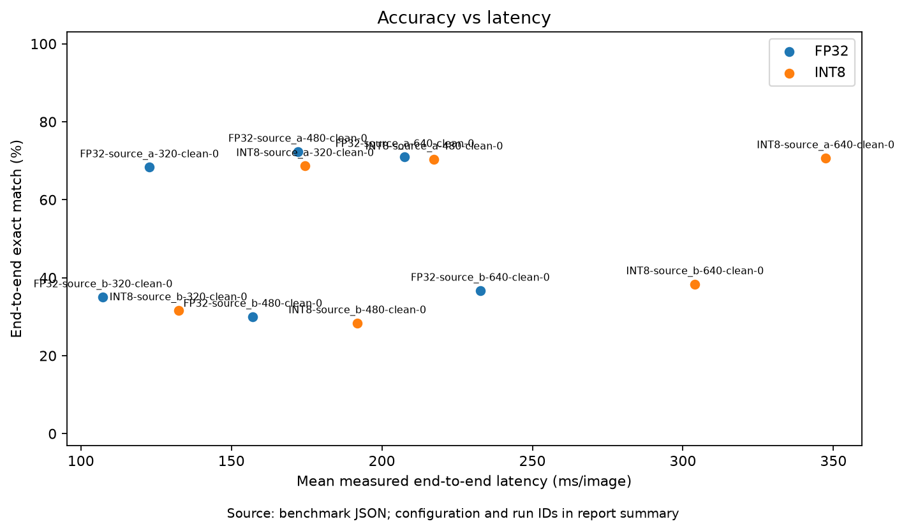
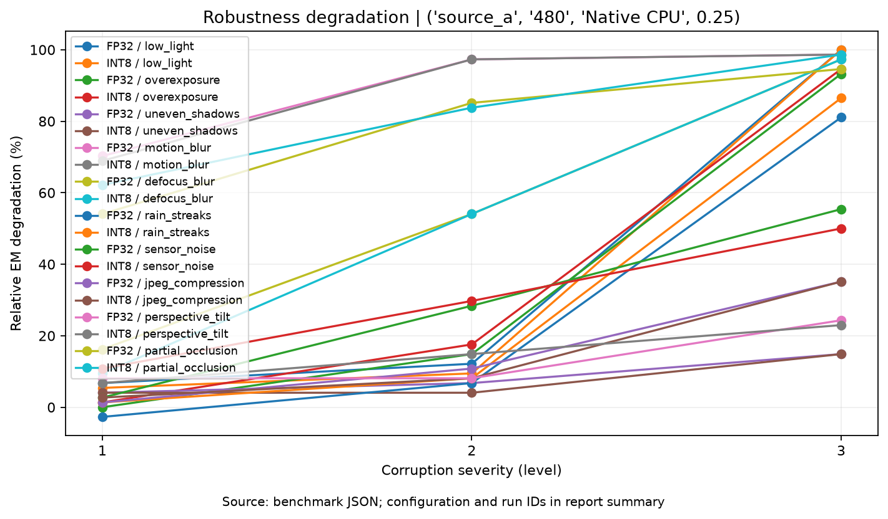
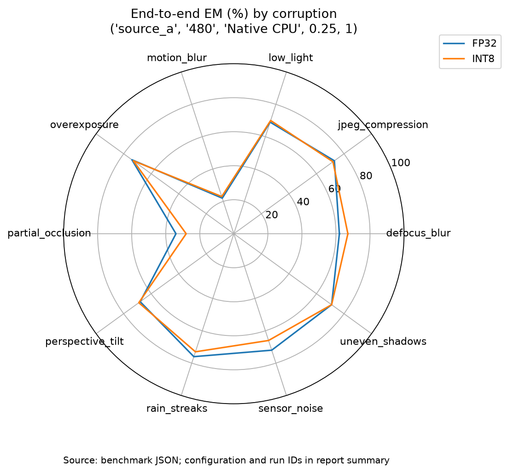
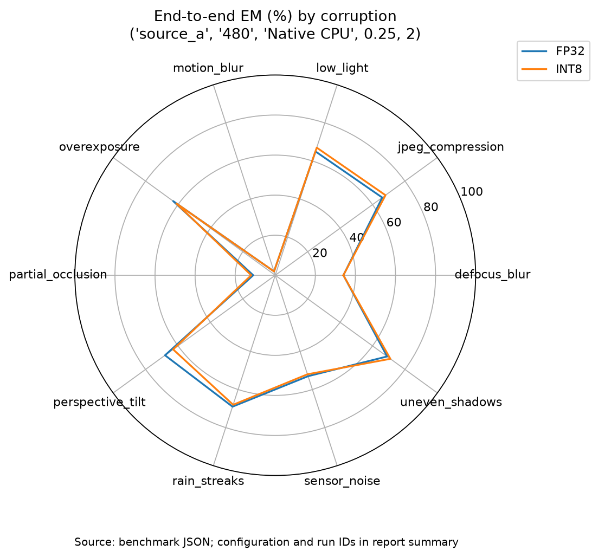
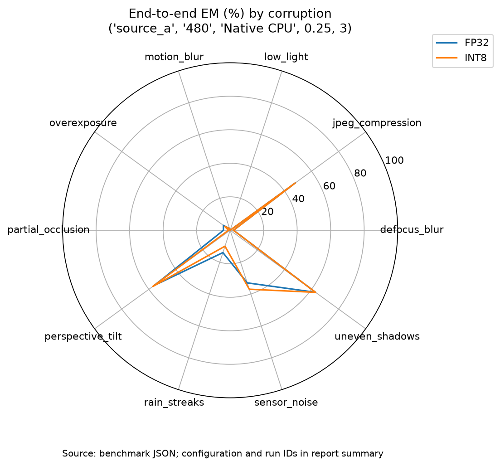

# 📊 Phase 6: Báo Cáo Thực Nghiệm Robustness Benchmark (FP32 vs INT8)

Tài liệu này tổng hợp toàn bộ kết quả đo đạc thực nghiệm chính thức của **Phase 6** trên cả 2 nguồn dữ liệu (**Source A** chuẩn hóa + sinh nhiễu nhân tạo và **Source B** ảnh hiện trường bất lợi), đối chiếu trực tiếp hiệu năng **Detection**, **OCR End-to-End**, **Độ bền bỉ (Robustness)**, **Độ trễ từng công đoạn** và **Phân tích lỗi** giữa **YOLOv8 ONNX FP32** (`weights/best.onnx`) và **YOLOv8 ONNX INT8** (`weights/best_int8.onnx`).

---

## 1. ⚙️ Thiết Lập Thực Nghiệm & Tính Minh Bạch Dữ Liệu

### 1.1. Môi trường & Tham số đo (`manifest.json`)
* **Thiết bị đo chính thức của đợt chạy ma trận:** Windows 11 AMD64 (`Windows-11-10.0.26200-SP0`), `Python 3.14.5`, `onnxruntime 1.30.0`, `opencv-python-headless 4.13.0.92`, `rapidocr-onnxruntime 1.2.3`, `numpy 2.5.0`, `psutil 7.2.2`, `matplotlib 3.11.2`.
* **Docker kiểm chứng đóng gói (`docker-compose.benchmark.yml`):** Container Linux headless (đã khắc phục lỗi `libxcb.so.1` trong [Dockerfile.benchmark](../Dockerfile.benchmark) bằng `libgl1`, `libglib2.0-0`, `libgomp1` và gỡ `opencv-python` để giữ `opencv-python-headless`) chạy `run_benchmark.py` và `visualizer.py` thành công với mã thoát `0` (`--sources source_a,source_b --models INT8 --resolutions 480 --sample-size 5`).
* **Chuẩn hóa lineage sinh nhiễu ([evaluation/corruptions.py](../evaluation/corruptions.py)):** Bổ sung `original_annotation_id`, `original_image_id`, `homography_matrix`, `dropped_annotations`, đường dẫn POSIX cho `manifest.json` và unit test trong [tests/test_corruptions.py](../tests/test_corruptions.py) (`63 tests` `unittest` đạt 100%).
* **Tham số benchmark thống nhất (`run_benchmark.py`):**
  * `detector_confidence = 0.001` (giữ ứng viên confidence thấp để tính all-points `AP@50`).
  * `confidence_threshold = 0.25`, `nms_iou = 0.45`, `threads = 4` (ONNX Runtime intra-op).
  * Chế độ benchmark: `profile=True`, `annotate=False`, `fallback_ocr=False` (tắt OCR toàn ảnh khi không phát hiện box để bảo toàn tính trung thực End-to-End).
  * Mã băm mô hình (`SHA-256` rút gọn): `FP32 best.onnx = 892eec62945f682c`, `INT8 best_int8.onnx = 3fc9e6f289db4523`.

### 1.2. Dữ liệu & Thống kê phạm vi
1. **Batch A — Full Clean Multi-Resolution Baseline (`output/full_clean_benchmark/`):**
   * **Source A (`300 ảnh / 300 biển`, `cohort_id: 062defd183ba2721`):** Đã lọc sạch **0 nhãn `UNKNOWN`**; phân bổ cân đối **150 xe máy (`moto`) / 150 ô tô (`car`)**, gồm **135 biển 1 dòng (`one_line`)** và **165 biển 2 dòng (`two_line`)**. Chạy đầy đủ `FP32, INT8` × `640, 480, 320` (`6` cell × `300` ảnh, `warmup=2`, `repeats=1`).
   * **Source B (`60 ảnh / 60 biển`, `cohort_id: 580192f8034b91fb`):** `0` ảnh trùng tên với Source A, `0` nhãn `UNKNOWN`, gồm **8 biển `one_line` / 52 biển `two_line`**, chia đều 4 nhóm thách thức thực tế (15 ảnh/nhóm). Chạy đầy đủ `FP32, INT8` × `640, 480, 320` (`6` cell × `60` ảnh).
2. **Batch B — Full 10-Scenario Robustness Matrix (`output/phase6_robustness_benchmark/`):**
   * Sinh trước toàn bộ **9.000 ảnh nhiễu** (`300` ảnh Source A × `10` kịch bản × `3` cấp độ, `seed=42`, thời gian sinh `264.22s`, **0 box bị rơi** qua kiểm tra `perspective_tilt`) tại `output/phase6_corrupted/`.
   * Chạy benchmark đồng nhất trên **cùng một cohort 100 ảnh Source A (`seed=42`, `cohort_id: d62623e9359cba80`)** — giữ tỉ lệ sát tập gốc (**47 `one_line` / 53 `two_line`**, **54 `car` / 46 `moto`**) — qua `clean` + **30 biến thể nhiễu (`10 × 3`)**, cộng toàn bộ **60 ảnh Source B**, cho cả `FP32` và `INT8` tại độ phân giải Pareto **`480×480`** (**64 cell**, `warmup=5`, `repeats=1`, tổng thời gian `1.661,62s` ≈ `27,7 phút`).

> [!NOTE]
> **Ghi chú minh bạch khoa học (Scientific Caveats):**
> 1. **Trạng thái nhãn (`quality_status: "exploratory"`):** Config đánh dấu `labels_verified: false` (cần cờ `--allow-pseudo-labels`) vì nhãn OCR chữ của Source A chứa nhãn sinh tự động trước đó kèm bản sửa sạch `UNKNOWN`. Các bảng trong báo cáo tách riêng từng nguồn và giữ nguyên quy ước `metrics.py`.
> 2. **Kiến trúc CPU x86 vs ARM:** Thời gian thực thi dưới đây đo trên CPU Windows `x86_64` (chủ yếu dùng để đối chiếu tốc độ tương đối và kiểm tra parity FP32/INT8), không phải số đo FPS vật lý trên Raspberry Pi 4 (số đo ARM nằm ở Phase 3–5).
> 3. **Quy ước Peak RAM:** Các cell chạy tuần tự trong cùng tiến trình Python (`reused_process_including_load_and_warmup`, chu kỳ lấy mẫu RSS `10 ms`), nên bộ nhớ cache của OS/allocator ở cell trước có thể ảnh hưởng mức RSS đỉnh quan sát ở cell sau.

---

## 2. 🧼 Kết Quả Clean Baseline Toàn Tập & Quy Mô Độ Phân Giải (`640 ➔ 320`)

*Nguồn: `output/full_clean_benchmark/` (`300` ảnh Source A + `60` ảnh Source B, tổng 2.160 lượt suy luận).*

### 2.1. Độ chính xác & Suy giảm theo độ phân giải (`FP32` vs `INT8`)

| Nguồn & Tập mẫu | Model | Res | `mAP@50` | Precision | Recall | EM Tổng | EM 1 dòng | EM 2 dòng | CER | Latency Mean (`P95`) | FPS | Peak RAM (MiB) |
| :--- | :---: | :---: | :---: | :---: | :---: | :---: | :---: | :---: | :---: | :---: | :---: | :---: |
| **Source A** *(n=300)* | **FP32** | `640` | **96.91%** | 85.37% | **95.33%** | 71.00% | **97.04%** | 49.70% | **0.1128** | 207.58 ms *(313.03)* | 4.82 | 362.52 |
| **Source A** *(n=300)* | **FP32** | `480` | 96.32% | 94.44% | 90.67% | **72.33%** | 95.56% | **53.33%** | 0.1414 | 172.04 ms *(255.80)* | 5.81 | 335.07 |
| **Source A** *(n=300)* | **FP32** | `320` | 95.10% | 93.99% | 88.67% | 68.33% | 96.30% | 45.45% | 0.1679 | **122.74 ms** *(192.89)* | **8.15** | 153.85 |
| **Source A** *(n=300)* | **INT8** | `640` | **96.57%** | 85.80% | **94.67%** | **70.67%** | 96.30% | **49.70%** | **0.1172** | 347.40 ms *(622.02)* | 2.88 | 157.19 |
| **Source A** *(n=300)* | **INT8** | `480` | 95.94% | 94.74% | 90.00% | 70.33% | 96.30% | 49.09% | 0.1510 | 217.34 ms *(313.44)* | 4.60 | 117.21 |
| **Source A** *(n=300)* | **INT8** | `320` | 95.54% | **97.05%** | 87.67% | 68.67% | 96.30% | 46.06% | 0.1696 | 174.45 ms *(255.55)* | 5.73 | **101.40** |
| **Source B** *(n=60)* | **FP32** | `640` | 63.10% | 73.47% | 60.00% | 36.67% | 62.50% | 32.69% | 0.5169 | 232.66 ms *(410.84)* | 4.30 | 150.79 |
| **Source B** *(n=60)* | **FP32** | `480` | 60.70% | 75.00% | 50.00% | 30.00% | 37.50% | 28.85% | 0.5753 | 157.10 ms *(263.22)* | 6.37 | 124.91 |
| **Source B** *(n=60)* | **FP32** | `320` | 54.68% | 84.85% | 46.67% | 35.00% | 50.00% | 32.69% | 0.5663 | **107.34 ms** *(223.21)* | **9.32** | 110.41 |
| **Source B** *(n=60)* | **INT8** | `640` | **65.95%** | 78.72% | **61.67%** | **38.33%** | **62.50%** | **34.62%** | **0.4652** | 303.98 ms *(423.81)* | 3.29 | 148.52 |
| **Source B** *(n=60)* | **INT8** | `480` | 62.11% | 76.92% | 50.00% | 28.33% | 37.50% | 26.92% | 0.5910 | 191.82 ms *(337.40)* | 5.21 | 118.80 |
| **Source B** *(n=60)* | **INT8** | `320` | 56.40% | **87.10%** | 45.00% | 31.67% | 25.00% | 32.69% | 0.5843 | 132.37 ms *(320.30)* | 7.55 | **103.27** |

### 2.2. Phân tách độ trễ từng công đoạn & Phân loại phương tiện trên Source A

| Run ID | Preprocess | Detection | Postprocess | Crop ROI | OCR | Total Mean | I/O (đọc file riêng) | `car` EM (n=150) | `moto` EM (n=150) |
| :--- | :---: | :---: | :---: | :---: | :---: | :---: | :---: | :---: | :---: |
| `FP32-source_a-640-clean-0` | 10.40 ms | 112.76 ms | 0.53 ms | 0.01 ms | 82.56 ms | 207.58 ms | 96.48 ms | **95.33%** *(mAP 100%)* | 46.67% *(mAP 92.52%)* |
| `FP32-source_a-480-clean-0` | 6.71 ms | 95.07 ms | 0.50 ms | 0.01 ms | 69.15 ms | 172.04 ms | 58.53 ms | 94.00% *(mAP 100%)* | **50.67%** *(mAP 90.98%)* |
| `FP32-source_a-320-clean-0` | 3.22 ms | 58.59 ms | 0.45 ms | 0.01 ms | 60.16 ms | 122.74 ms | 25.70 ms | 94.67% *(mAP 99.99%)* | 42.00% *(mAP 88.37%)* |
| `INT8-source_a-640-clean-0` | 9.22 ms | 244.84 ms | 0.66 ms | 0.01 ms | 91.32 ms | 347.40 ms | 63.50 ms | 94.00% *(mAP 100%)* | 47.33% *(mAP 91.93%)* |
| `INT8-source_a-480-clean-0` | 6.01 ms | 140.27 ms | 0.48 ms | 0.01 ms | 70.00 ms | 217.34 ms | 55.25 ms | **94.67%** *(mAP 100%)* | 46.00% *(mAP 90.47%)* |
| `INT8-source_a-320-clean-0` | 3.52 ms | 104.52 ms | 0.45 ms | 0.01 ms | 65.61 ms | 174.45 ms | 7.19 ms | 94.00% *(mAP 99.99%)* | 43.33% *(mAP 90.08%)* |

**Nhận xét chính từ Clean Baseline:**
1. **Khoảng cách Ô tô vs Xe máy / 1 dòng vs 2 dòng:** Trên ô tô (`150` ảnh), Detector đạt **mAP@50 = 100.00%** (tại 640 và 480 cho cả FP32 lẫn INT8) và EM đạt **94.0%–95.3%** (`one_line` đạt **95.6%–97.0%**). Ngược lại, trên xe máy (`two_line`, `165` ảnh), EM giảm còn **45.5%–53.3%** dù Recall vẫn đạt `75.3%–90.7%` — chứng tỏ **tầng OCR + tách 2 dòng là điểm nghẽn độ chính xác lớn nhất**, đặc biệt khi xuống `320×320` (Recall xe máy tụt từ ~90% ở 640 xuống 75.3%–77.3% ở 320).
2. **Xác nhận điểm ngọt `480×480` trên cả FP32 và INT8:** Hạ từ `640` xuống `480` giữ nguyên EM (`72.33% vs 71.00%` ở FP32; `70.33% vs 70.67%` ở INT8), Precision thậm chí **tăng mạnh** từ `85.4%–85.8%` lên `94.4%–94.7%` (giảm 2/3 lượng False Positive) nhờ bớt nhiễu nền độ phân giải cao.
3. **Hiệu ứng kiến trúc x86 vs ARM với INT8:** Trên CPU desktop `x86_64`, `best_int8.onnx` (`QUInt8`) suy luận detection chậm hơn FP32 (`140.27 ms` vs `95.07 ms` ở 480) do thiếu tập lệnh VNNI chuyên dụng và tốn chi phí dequantize, nhưng vẫn giữ Peak RAM nhẹ hơn (`117.2 MiB` so với `335.1 MiB` ở `480`) và giữ gần như nguyên vẹn `mAP@50` (`95.94%` vs `96.32%`).



---

## 3. 🌪️ Ma Trận Độ Bền Bỉ 10 Kịch Bản Nhiễu × 3 Mức Độ (FP32 vs INT8)

*Nguồn: `output/phase6_robustness_benchmark/` và `output/phase6_report/` (`480×480`, cùng cohort `100` ảnh Source A `d62623e9359cba80` — 47 `one_line` / 53 `two_line`).*

*Clean baseline trên cohort này:*
* **FP32 (`FP32-source_a-480-clean-0`):** `mAP@50 = 97.84%`, Precision `95.88%`, Recall `93.00%`, **EM = 74.00%** (`1L: 95.74%`, `2L: 54.72%`), `CER = 0.1261`, Total `214.15 ms` (`4.67 FPS`).
* **INT8 (`INT8-source_a-480-clean-0`):** `mAP@50 = 97.48%`, Precision `95.88%`, Recall `93.00%`, **EM = 74.00%** (`1L: 95.74%`, `2L: 54.72%`), `CER = 0.1175`, Total `263.08 ms` (`3.80 FPS`).

### 3.1. Bảng đối chiếu đầy đủ 30 biến thể nhiễu (4 nhóm × 10 kịch bản × Level 1–3)

*Ký hiệu: `Deg (%)` = `(EM_clean - EM_corrupted) / EM_clean × 100`; `ΔIoU` = `1 - IoU(Box_clean, Box_corrupted)` trung bình trên các cặp box khớp cả 2 chiều (riêng `perspective_tilt` đã biến đổi box clean qua `homography_matrix` theo chuẩn `METRICS.md`).*

| Kịch bản nhiễu | Lvl | FP32 `mAP@50` | INT8 `mAP@50` | FP32 Recall | INT8 Recall | FP32 EM (1L / 2L) | INT8 EM (1L / 2L) | FP32 CER | INT8 CER | FP32 Deg | INT8 Deg | `ΔIoU` *(FP32 / INT8)* |
| :--- | :-: | :---: | :---: | :---: | :---: | :---: | :---: | :---: | :---: | :---: | :---: | :---: |
| **`low_light`** *(Quang học)* | 1 | 97.97% | 97.66% | 92% | 91% | 69.0% *(93.6 / 47.2)* | 70.0% *(91.5 / 50.9)* | 0.1322 | 0.1432 | 6.76% | 5.41% | 0.0197 / 0.0207 |
| | 2 | 95.53% | 95.03% | 89% | 90% | 65.0% *(87.2 / 45.3)* | 67.0% *(87.2 / 49.1)* | 0.1726 | 0.1628 | 12.16% | 9.46% | 0.0498 / 0.0501 |
| | 3 | 56.58% | 59.75% | 29% | 32% | **0.0%** *(0.0 / 0.0)* | **0.0%** *(0.0 / 0.0)* | 1.0000 | 1.0000 | 100.00% | 100.00% | 0.1256 / 0.1243 |
| **`overexposure`** *(Quang học)* | 1 | 97.82% | 97.82% | 94% | 93% | 74.0% *(97.9 / 52.8)* | 73.0% *(95.7 / 52.8)* | 0.1346 | 0.1346 | 0.00% | 1.35% | 0.0064 / 0.0104 |
| | 2 | 97.97% | 97.79% | 94% | 93% | 63.0% *(87.2 / 41.5)* | 61.0% *(85.1 / 39.6)* | 0.1701 | 0.1934 | 14.86% | 17.57% | 0.0316 / 0.0311 |
| | 3 | 51.43% | 50.94% | 37% | 35% | 5.0% *(8.5 / 1.9)* | 4.0% *(6.4 / 1.9)* | 0.8825 | 0.8800 | 93.24% | 94.59% | 0.2133 / 0.2255 |
| **`uneven_shadows`** *(Quang học)* | 1 | 97.88% | 97.76% | 93% | 90% | 71.0% *(93.6 / 50.9)* | 71.0% *(93.6 / 50.9)* | 0.1359 | 0.1603 | 4.05% | 4.05% | 0.0159 / 0.0194 |
| | 2 | 95.12% | 95.03% | 90% | 91% | 69.0% *(97.9 / 43.4)* | 71.0% *(95.7 / 49.1)* | 0.1652 | 0.1554 | 6.76% | 4.05% | 0.0341 / 0.0343 |
| | 3 | 91.88% | 91.36% | 82% | 80% | **63.0%** *(93.6 / 35.9)* | **63.0%** *(93.6 / 35.9)* | 0.2766 | 0.2876 | **14.86%** | **14.86%** | 0.0456 / 0.0483 |
| **`motion_blur`** *(Mờ/CĐ)* | 1 | 95.85% | 96.00% | 92% | 92% | **22.0%** *(34.0 / 11.3)* | **23.0%** *(34.0 / 13.2)* | 0.3525 | 0.3525 | 70.27% | 68.92% | 0.0771 / 0.0791 |
| | 2 | 95.74% | 94.12% | 91% | 90% | 2.0% *(0.0 / 3.8)* | 2.0% *(0.0 / 3.8)* | 0.9523 | 0.9547 | 97.30% | 97.30% | 0.1267 / 0.1265 |
| | 3 | 92.46% | 93.09% | 84% | 85% | 1.0% *(0.0 / 1.9)* | 1.0% *(0.0 / 1.9)* | 0.9792 | 0.9743 | 98.65% | 98.65% | 0.1738 / 0.1783 |
| **`defocus_blur`** *(Mờ/CĐ)* | 1 | 97.15% | 97.23% | 93% | 92% | 62.0% *(91.5 / 35.9)* | 67.0% *(93.6 / 43.4)* | 0.1432 | 0.1530 | 16.22% | 9.46% | 0.0386 / 0.0397 |
| | 2 | 93.06% | 93.64% | 86% | 84% | 34.0% *(44.7 / 24.5)* | 34.0% *(48.9 / 20.8)* | 0.3660 | 0.3660 | 54.05% | 54.05% | 0.1013 / 0.1034 |
| | 3 | 82.37% | 82.46% | 67% | 68% | 2.0% *(0.0 / 3.8)* | 2.0% *(0.0 / 3.8)* | 0.9339 | 0.9498 | 97.30% | 97.30% | 0.1570 / 0.1584 |
| **`rain_streaks`** *(Môi trường)* | 1 | 98.45% | 98.36% | 94% | 94% | **76.0%** *(95.7 / 58.5)* | 73.0% *(95.7 / 52.8)* | 0.1200 | 0.1212 | -2.70% | 1.35% | 0.0082 / 0.0126 |
| | 2 | 98.21% | 98.39% | 93% | 93% | 69.0% *(93.6 / 47.2)* | 68.0% *(93.6 / 45.3)* | 0.1506 | 0.1518 | 6.76% | 8.11% | 0.0251 / 0.0269 |
| | 3 | 66.75% | 66.29% | 42% | 41% | 14.0% *(25.5 / 3.8)* | 10.0% *(21.3 / 0.0)* | 0.7650 | 0.7882 | 81.08% | 86.49% | 0.0841 / 0.0867 |
| **`sensor_noise`** *(Môi trường)* | 1 | 99.61% | 99.31% | 98% | 96% | 72.0% *(93.6 / 52.8)* | 66.0% *(91.5 / 43.4)* | 0.1236 | 0.1395 | 2.70% | 10.81% | 0.0309 / 0.0312 |
| | 2 | 98.35% | 97.67% | 97% | 97% | 53.0% *(78.7 / 30.2)* | 52.0% *(78.7 / 28.3)* | 0.2203 | 0.2485 | 28.38% | 29.73% | 0.0464 / 0.0490 |
| | 3 | 97.44% | 97.23% | 96% | 96% | 33.0% *(53.2 / 15.1)* | 37.0% *(57.5 / 18.9)* | 0.3672 | 0.3758 | 55.41% | 50.00% | 0.0604 / 0.0587 |
| **`jpeg_compression`** *(Truyền dẫn)* | 1 | 98.08% | 98.10% | 93% | 93% | 73.0% *(93.6 / 54.7)* | 72.0% *(91.5 / 54.7)* | 0.1297 | 0.1200 | 1.35% | 2.70% | 0.0109 / 0.0128 |
| | 2 | 99.03% | 98.78% | 95% | 95% | 66.0% *(85.1 / 49.1)* | 68.0% *(85.1 / 52.8)* | 0.1273 | 0.1310 | 10.81% | 8.11% | 0.0142 / 0.0175 |
| | 3 | 98.22% | 98.56% | 95% | 95% | 48.0% *(61.7 / 35.9)* | 48.0% *(61.7 / 35.9)* | 0.2179 | 0.2326 | 35.14% | 35.14% | 0.0320 / 0.0342 |
| **`perspective_tilt`** *(Hình học)* | 1 | 96.36% | 95.65% | 90% | 89% | 68.0% *(95.7 / 43.4)* | 69.0% *(95.7 / 45.3)* | 0.1689 | 0.1775 | 8.11% | 6.76% | 0.0482 / 0.0489 |
| | 2 | 95.35% | 94.95% | 88% | 88% | 68.0% *(95.7 / 43.4)* | 63.0% *(91.5 / 37.7)* | 0.1958 | 0.1983 | 8.11% | 14.86% | 0.0686 / 0.0693 |
| | 3 | 81.37% | 80.44% | 74% | 74% | 56.0% *(87.2 / 28.3)* | 57.0% *(89.4 / 28.3)* | 0.3280 | 0.3207 | 24.32% | 22.97% | 0.1186 / 0.1196 |
| **`partial_occlusion`** *(Hình học)* | 1 | 96.95% | 96.99% | 91% | 91% | 34.0% *(46.8 / 22.6)* | 28.0% *(42.6 / 15.1)* | 0.2840 | 0.2950 | 54.05% | 62.16% | 0.0158 / 0.0195 |
| | 2 | 95.04% | 95.29% | 89% | 88% | 11.0% *(17.0 / 5.7)* | 12.0% *(19.2 / 5.7)* | 0.3709 | 0.3709 | 85.14% | 83.78% | 0.0272 / 0.0300 |
| | 3 | 94.05% | 93.63% | 85% | 83% | 4.0% *(4.3 / 3.8)* | 1.0% *(0.0 / 1.9)* | 0.5410 | 0.5667 | 94.59% | 98.65% | 0.0374 / 0.0395 |

### 3.2. Tổng hợp đối đầu FP32 vs INT8 qua 3 cấp độ nhiễu

| Phạm vi tổng hợp | Model | Mean `mAP@50` | Mean EM Tổng | Mean EM `1L` | Mean EM `2L` | Mean CER | Mean Degradation (%) | Chênh lệch (`INT8 - FP32`) |
| :--- | :---: | :---: | :---: | :---: | :---: | :---: | :---: | :---: |
| **Level 1** *(10 kịch bản)* | FP32 / INT8 | 97.61% / 97.49% | 62.10% / 61.20% | 83.62% / 82.55% | 43.02% / 42.26% | 0.1725 / 0.1797 | 16.08% / 17.30% | `mAP -0.12pp` \| `EM -0.90pp` |
| **Level 2** *(10 kịch bản)* | FP32 / INT8 | 96.34% / 96.07% | 50.00% / 49.80% | 68.72% / 68.51% | 33.40% / 33.21% | 0.2891 / 0.2933 | 32.43% / 32.70% | `mAP -0.27pp` \| `EM -0.20pp` |
| **Level 3** *(10 kịch bản)* | FP32 / INT8 | 81.26% / 81.38% | 22.60% / 22.30% | 33.40% / 32.98% | 13.02% / 12.83% | 0.6291 / 0.6376 | 69.46% / 69.86% | `mAP +0.12pp` \| `EM -0.30pp` |
| **Trung bình 30 biến thể** | **FP32 / INT8** | **91.74% / 91.64%** | **44.90% / 44.43%** | **61.91% / 61.35%** | **29.81% / 29.43%** | **0.3636 / 0.3702** | **39.32% / 39.95%** | **`mAP -0.09pp` \| `EM -0.47pp`** |

> [!IMPORTANT]
> **Kết luận cốt lõi của Phase 6:**
> Trên toàn bộ **3.000 lượt đánh giá môi trường xấu** (`10` kịch bản × `3` cấp độ × `100` ảnh), nén **YOLOv8 INT8 (giảm 72.6% dung lượng, 3.20 MB)** gần như **KHÔNG làm tăng tính nhạy cảm trước nhiễu**: độ lệch trung bình có dấu so với FP32 chỉ là **-0.09 điểm phần trăm `mAP@50`** và **-0.47 điểm phần trăm `EM`** (`MAE = 1.80pp`, độ lệch cực đại trên 1 cell đơn lẻ là `±6.00pp`, thậm chí INT8 nhỉnh hơn ở `defocus_blur L1` `+5.0pp` và `sensor_noise L3` `+4.0pp`). Toàn bộ đường bao trên 3 biểu đồ Radar (`radar_0..2.png`) của FP32 và INT8 gần như trùng khít.

### 3.3. Biểu đồ trực quan hóa Suy giảm & Radar (FP32 vs INT8)



| Level 1 *(Nhẹ)* | Level 2 *(Vừa)* | Level 3 *(Nặng)* |
| :---: | :---: | :---: |
|  |  |  |

---

## 4. 🛣️ Phân Tích Lát Cắt Source B Thực Địa & Đối Chiếu Sim-to-Real

*Nguồn: `output/full_clean_benchmark/` (`60` ảnh thật từ `datasets/source_b/`, phân bổ 15 ảnh/nhóm thách thức).*

| Nhóm Thách Thức Thực Địa *(Source B)* | Tỉ lệ biển 2 dòng (`2L`) | Độ sáng *(Mean)* | Độ nét Laplace *(Mean)* | `640`: `mAP@50` *(FP32 / INT8)* | `640`: EM *(FP32 / INT8)* | `480`: `mAP@50` *(FP32 / INT8)* | `480`: EM *(FP32 / INT8)* | `320`: `mAP@50` *(FP32 / INT8)* | `320`: EM *(FP32 / INT8)* |
| :--- | :---: | :---: | :---: | :---: | :---: | :---: | :---: | :---: | :---: |
| **1. `Low Light`** *(n=15)* | 12/15 *(80%)* | `61.8` *[51.8..67.7]* | `492.9` | 80.31% / 80.31% | **60.00%** / 53.33% | 76.81% / 76.83% | 46.67% / 46.67% | 70.62% / 70.62% | 53.33% / 40.00% |
| **2. `Motion / Defocus Blur`** *(n=15)* | 12/15 *(80%)* | `93.8` *[68.3..124.5]* | `219.0` | 65.91% / 65.52% | 46.67% / 46.67% | **71.90% / 71.90%** | 40.00% / 40.00% | 67.95% / 67.94% | 46.67% / 40.00% |
| **3. `High Glare / Overexposure`** *(n=15)* | 13/15 *(87%)* | `145.6` *[125.0..189.6]* | `399.9` | 48.55% / **54.00%** | 33.33% / **40.00%** | 32.01% / 35.43% | 26.67% / 20.00% | 42.34% / 43.70% | 33.33% / 33.33% |
| **4. `Geometry / Perspective Tilt`** *(n=15)* | **15/15 *(100%)*** | `102.0` *[76.7..122.1]* | `780.8` | 60.05% / **66.41%** | 6.67% / **13.33%** | 65.30% / 66.37% | **6.67% / 6.67%** | 42.01% / 46.81% | 6.67% / 13.33% |
| **Tổng Source B** *(n=60)* | **52/60 *(86.7%)*** | — | — | 63.10% / **65.95%** | 36.67% / **38.33%** | 60.70% / 62.11% | 30.00% / 28.33% | 54.68% / 56.40% | 35.00% / 31.67% |

**Phát hiện quan trọng từ kiểm chứng Sim-to-Real:**
1. **Lý do Source B khó hơn hẳn Source A (`EM 28.3%–38.3%` so với `70.3%–72.3%`):** Có tới **52/60 ảnh (86.7%)** trong Source B là biển vuông 2 dòng xe máy (`two_line`) — nhóm vốn chỉ đạt `49%–53%` EM ngay cả trong ảnh sạch Source A — lại cộng hưởng đồng thời nhiều điều kiện khó thực tế.
2. **Độ chênh lệch mô phỏng vs thực địa ở góc nghiêng (`Perspective Tilt`) & Chói đèn (`Glare`):**
   * Trong mô phỏng Source A, `perspective_tilt-1..3` vẫn giữ được EM `56%–69%` (vì 47% mẫu là biển 1 dòng ô tô và góc phẳng đồng nhất). Ngoài đời thực (`Source B Geometry`), **100% ảnh (15/15)** là biển 2 dòng xe máy góc chéo kèm thân xe phức tạp khiến Recall tại `480` chỉ còn `33.33%` và EM tụt xuống **6.67%** (`CER = 0.84–0.87`).
   * Ở nhóm `High Glare / Overexposure`, chói lóa thực tế (`blooming`, mất nét viền trắng xung quanh đèn pha) kéo `mAP@50` tụt xuống `32.0%–35.4%` tại `480` (`48.6%–54.0%` tại `640`) — tương ứng giữa mức `overexposure` Level 2 và Level 3 trên Source A.
3. **INT8 giữ ổn định hơn cả FP32 trên dữ liệu thực địa ở `640` và `480` detect:** Tại `640×640`, INT8 đạt `mAP@50 = 65.95%` và `EM = 38.33%` (nhỉnh hơn `63.10%` và `36.67%` của FP32), khẳng định lượng tử hóa INT8 không làm mất khả năng tổng quát hóa ngoài thực địa.

---

## 5. 🔍 Chẩn Đoán Ca Lỗi & Nguyên Nhân Gốc Rễ (`error_analysis.py`)

Tổng hợp **3.840 ca lỗi** trích xuất tại `output/phase6_report/failures/cases.json` (qua cả 64 run `480×480`) và **605 ca lỗi** clean tại `480` trên toàn bộ Source A + Source B cho thấy 3 mô thức sụp đổ rõ rệt:

| Cơ chế lỗi chính | Kịch bản kích hoạt mạnh nhất | Thống kê điển hình (`INT8-480`, `n=100`) | Ví dụ thực tế trích từ `cases.json` | Nguyên nhân gốc rễ |
| :--- | :--- | :--- | :--- | :--- |
| **1. Detector Collapse** *(Bỏ sót BBox)* | `low_light-3`, `overexposure-3`, `rain_streaks-3` | `miss_detection`: **68** (`low_light-3`), **65** (`overexposure-3`), **59** (`rain_streaks-3`) | Tối mịt / lóa trắng mất tương phản cạnh biên hộp biển số | Mất gradient biên ở ảnh đầu vào khiến YOLOv8 không đạt ngưỡng confidence `0.25`. |
| **2. OCR Collapse sớm** *(Detect được nhưng đọc sai/rỗng)* | `motion_blur-1..3`, `partial_occlusion-1..3`, `defocus_blur-2..3`, `sensor_noise-3` | `motion_blur-1`: chỉ **8 miss**, **69 `ocr_mismatch`**; `partial_occlusion-1`: **9 miss**, **63 `ocr_mismatch`**; `low_light-3`: **32/32 box bắt được đều `ocr_mismatch`** | `motion_blur-1`: `51G-222.37 → 51G-272.37` (conf `0.939`); `partial_occlusion-1`: `51G-436.30 → 51G-4360` (conf `0.945`); `low_light-3`: `65B1-045.66 → ''` (conf `0.938`) | DBNet nhạy với nhòe biên ký tự (`motion_blur`) và vết đốm che nét (`partial_occlusion`), trong khi CTC/CRNN không tự phục hồi ký tự thiếu khi tắt beam/post-dict. |
| **3. AABB Tilt Drift & Biển 2 dòng** | `perspective_tilt-3`, `Source B Geometry`, `Source A moto` | `perspective_tilt-3`: **49 `false_positive`** (conf lên tới `0.945`) + **26 `miss_detection`** | `perspective_tilt-3`: `86F9-7974 → 86F-9797`; `Source A clean`: `94R1-9764 → 9764` (mất dòng trên); `Source B`: `63C1-3900 → 63C` | Khi nghiêng 45°, nhãn GT trục-thẳng (AABB) nở rộng khiến box detector chặt hơn rớt nhẹ dưới `IoU 0.50` (tạo cặp 1 FP + 1 FN); đồng thời RapidOCR thường bỏ sót hoặc đảo dòng trên của biển vuông xe máy. |

---

## 6. 📋 Đối Chiếu Với Paper 23 & Sản Phẩm Đầu Ra

1. **Khắc phục triệt để 4 lỗ hổng của Paper 23 (`Jagtap & Dhawale, 2025`):**
   * **Thay thế bộ dữ liệu hộp đen:** Công khai rõ cohort (`300 Source A` + `60 Source B` + `9.000 ảnh nhiễu` kiểm soát 10 kịch bản × 3 mức độ, kèm `cohort_id` và `SHA-256`).
   * **Thay thế thước đo mơ hồ ("OCR Accuracy"):** Tách bạch rành mạch `mAP@50` (Detection, `conf >= 0.001`), `EM (%)` và `CER` theo Levenshtein (OCR End-to-End có tính cả miss detection, tách riêng `one_line` vs `two_line`), `Robustness Degradation (%)`, và `ΔIoU`.
   * **Phản biện thực nghiệm định lượng:** Paper 23 báo cáo "OCR Accuracy" ổn định ở mức 80.9%–89.0% trên thời tiết xấu nhưng không nêu rõ là character-level hay exact match, cũng không thử nghiệm trên biển 2 dòng. Kết quả của chúng tôi cho thấy: trong cùng hệ thống có `mAP@50 > 92%`, **Exact Match cả biển số** trên biển 2 dòng hoặc dưới tác động của `motion_blur` / `partial_occlusion` sụt giảm khốc liệt hơn rất nhiều so với suy giảm của Detector — điều chỉ lộ ra khi đo End-to-End Exact Match nghiêm ngặt.

2. **Vị trí các báo cáo, biểu đồ và tệp dữ liệu đã sinh (`output/`):**
   * **Báo cáo & Biểu đồ Robustness đầy đủ (64 runs, `480×480`):**
     * Dữ liệu thô & bảng tổng hợp: `output/phase6_robustness_benchmark/runs.csv`, `samples.csv`, `benchmark.json`, `manifest.json`; `output/phase6_report/summary.json`, `summary.csv`, `report.md`, `failures/cases.json`.
     * Biểu đồ trực quan hóa: `output/phase6_report/degradation_0.png/.svg` (đường cong suy giảm Level 1–3), `radar_0.png/.svg` (Level 1), `radar_1.png/.svg` (Level 2), `radar_2.png/.svg` (Level 3), `accuracy_latency.png/.svg`.
   * **Báo cáo Clean Multi-Resolution toàn tập (12 runs, `300 Source A + 60 Source B` × `640/480/320`):** `output/full_clean_benchmark/` và `output/full_clean_report/summary.json`, `report.md`, `accuracy_latency.png/.svg`, `output/full_clean_failures/cases.json`.

3. **Hướng cải tiến tiếp theo (Future Work):**
   * **Khử nghiêng ROI (Rectification) trước OCR:** Chỉnh phối cảnh vùng cắt biển số 2 dòng bị nghiêng (`Perspective Transform` nhẹ hoặc deskew trước khi nạp vào RapidOCR `H=96`) để cứu tỷ lệ EM nhóm `Geometry / Perspective Tilt` và biển xe máy.
   * **Tăng cường cân bằng sáng cục bộ (CLAHE / Gamma Adaptive) chỉ kích hoạt khi ROI quá tối:** Tránh sụp đổ `OCR=0%` tại `low_light-3` trong khi Detector vẫn phát hiện được ~30% biển.
   * **Tinh chỉnh hậu xử lý & mô hình OCR chuyên biệt biển 2 dòng:** Xác thực nhãn thủ công 100% (`labels_verified: true`) cho Source A để tách rạch ròi nhiễu pseudo-label khỏi năng lực OCR thực tế.

---

## 7. 🚀 Lệnh Tái Lập Thực Nghiệm

```powershell
# 1. Sinh 9.000 ảnh nhiễu từ 300 ảnh Source A (0 dropped boxes)
python -m evaluation.corruptions --input-dir datasets/source_a/images --annotations datasets/source_a/_annotations.coco.json --output-dir output/phase6_corrupted --scenarios all --severities 1,2,3 --seed 42

# 2. Chạy toàn bộ ma trận Robustness 64 cell (FP32 vs INT8 @ 480, cohort 100 Source A + 60 Source B)
python -m evaluation.run_benchmark --config output/phase6_benchmark_config.json --sources source_a,source_b --models FP32,INT8 --resolutions 480 --corruptions all --severities 1,2,3 --sample-size 100 --warmup 5 --repeats 1 --threads 4 --seed 42 --profile "Native CPU" --allow-pseudo-labels --output output/phase6_robustness_benchmark --overwrite

# 3. Xuất bộ biểu đồ Radar / Degradation / Failure Cases
python -m evaluation.visualizer --input output/phase6_robustness_benchmark/benchmark.json --output output/phase6_report --image-root .

# 4. Chạy trong container Docker headless (đã kiểm chứng libgl1 + opencv-python-headless)
docker compose -f docker-compose.benchmark.yml run --build --rm benchmark python -m evaluation.run_benchmark --config evaluation/benchmark_config.json --sources source_a,source_b --models INT8 --resolutions 480 --sample-size 5 --warmup 2 --repeats 1 --allow-pseudo-labels --output output/docker_smoke --overwrite
```
