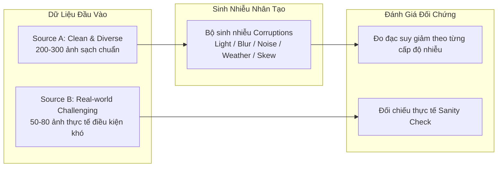

# 🛡️ Phase 6: Khung Đánh Giá Độ Bền Bỉ (Robustness Benchmark) & Chuẩn Bị Dữ Liệu Kiểm Thử

---

## 1. 🎯 Mục Tiêu & Bối Cảnh (Context & Objectives)

Sau khi hoàn tất **Phase 1 đến Phase 5**, hệ thống ALPR đã đạt được bước nhảy vọt về tốc độ suy luận và tối ưu tài nguyên trên thiết bị nhúng:
* Kích thước mô hình giảm **72.6%** (11.7MB $\rightarrow$ 3.2MB nhờ Dynamic INT8).
* Tiêu thụ RAM giảm **83.8%** (~53MB).
* Thời gian xử lý End-to-End giảm từ **4.18s xuống ~668ms (~1.5 FPS)** trên Raspberry Pi 4.

Tuy nhiên, toàn bộ các đo đạc trước đây chủ yếu tập trung vào **tốc độ (Latency) và tài nguyên (Compute/RAM)** trên tập mẫu chuẩn (`samples/`). **Phase 6** được thiết kế nhằm chuẩn bị hạ tầng kiểm thử toàn diện về **độ chính xác (Accuracy) và độ bền bỉ (Robustness)** trước các điều kiện môi trường bất lợi thực tế tại cổng an ninh (trời tối, đèn pha chói, trời mưa, biển mờ bẩn, xe chạy nghiêng góc).

---

## 2. 📂 Chiến Lược Dữ Liệu 2 Nguồn (Two-Tier Test Dataset Strategy)

Trong nghiên cứu thị giác máy tính, việc chỉ dựa vào ảnh chụp ngoài đời sẽ gặp hạn chế: khó thu thập đủ mọi biến thể thời tiết trên cùng một góc máy và không thể kiểm soát định lượng mức độ nhiễu. Do đó, Phase 6 chuẩn hóa phương pháp tiếp cận gồm **2 nguồn dữ liệu độc lập**:



### A. Source A: Tập Dữ Liệu Gốc Đa Dạng (Clean & Diverse Baseline)
* **Quy mô:** ~200 – 300 ảnh.
* **Đặc tính:** Chụp rõ nét ở điều kiện ánh sáng chuẩn, đa dạng về phân loại:
  - Tỉ lệ phương tiện: Xe máy vs Ô tô (~50/50).
  - Định dạng biển: Biển 1 dòng (dài) vs Biển 2 dòng (vuông).
  - Màu sắc biển số: Biển trắng dân sự, biển vàng thương mại/dịch vụ.
* **Mục đích:** Đóng vai trò là **Ground Truth chuẩn** để áp dụng các thuật toán sinh nhiễu tự động với các cấp độ kiểm soát được từ nhẹ đến nặng.
* **Đường dẫn dự kiến:** [datasets/source_a/](file:///d:/project-coding-files/github/261002_SEP490_SecurityGate/research/datasets/source_a/)

### B. Source B: Tập Ảnh Thực Tế Điều Kiện Bất Lợi (Real-World Challenging Set)
* **Quy mô:** ~50 – 80 ảnh.
* **Đặc tính:** Ảnh chụp thực tế tại hiện trường các tình huống khó khăn:
  - Ánh sáng ban đêm, thiếu sáng hầm gửi xe, bóng cây loang lổ.
  - Ngược sáng mạnh hoặc chói lóa do đèn pha chiếu thẳng vào camera.
  - Biển số bị xước, bám bùn đất, ốc vít che chữ số.
  - Xe dừng chéo góc làn hoặc góc camera lắp cao nghiêng.
* **Mục đích:** Dùng làm **tập thẩm định đối chiếu (Sanity Check)**: kiểm chứng xem xu hướng sụt giảm độ chính xác trên ảnh mô phỏng (Source A + Noise) có phản ánh đúng thực tế ở Source B hay không.
* **Đường dẫn dự kiến:** [datasets/source_b/](file:///d:/project-coding-files/github/261002_SEP490_SecurityGate/research/datasets/source_b/)

---

## 3. 🧪 Bộ Kịch Bản Sinh Nhiễu Nhân Tạo (Synthetic Perturbations Matrix)

Các hàm biến đổi ảnh tự động được chia làm 4 nhóm chính, mỗi nhóm hỗ trợ 3 mức độ nghiêm trọng (**Level 1: Nhẹ | Level 2: Vừa | Level 3: Nặng**):

| Nhóm Nhiễu | Tên Kịch Bản | Mô Phỏng Thực Tế | Phương Pháp Thực Hiện (OpenCV/Albumentations) |
| :--- | :--- | :--- | :--- |
| **Quang Học & Ánh Sáng** | `Low-Light` | Ban đêm, hầm xe thiếu sáng | Giảm giá trị kênh V trong HSV, giảm hệ số Gamma ($\gamma < 0.6$). |
| | `Overexposure / Glare` | Đèn pha rọi thẳng, chói nắng | Tạo điểm sáng cực đại cục bộ (Gaussian glare blob) trên vùng biển số. |
| | `Uneven Shadows` | Mái che, cành cây đổ bóng | Áp mặt nạ alpha giảm sáng 40-60% trên nửa diện tích biển. |
| **Mờ & Chuyển Động** | `Motion Blur` | Xe chưa dừng hẳn trước barrier | Áp kernel tích chập chuyển động theo hướng ngang/chéo ($k=7, 15, 25$). |
| | `Defocus Blur` | Camera lệch tiêu cự | Áp làm mờ Gaussian diện rộng ($k=5, 9, 15$). |
| **Môi Trường & Truyền Dẫn** | `Rain Streaks` | Trời mưa rào hắt vào ống kính | Vẽ các vệt mưa ngẫu nhiên nghiêng $60^\circ-80^\circ$ với độ mờ trong suốt. |
| | `Sensor Noise` | Camera đẩy ISO cao lúc trời tối | Thêm nhiễu Gauss ($\sigma = 15, 30, 50$). |
| | `JPEG Compression` | Luồng RTSP nén bitrate thấp | Nén và giải nén lại ảnh ở chất lượng JPEG thấp ($Q = 30, 15, 5$). |
| **Hình Học & Vật Lý** | `Perspective Tilt` | Xe vào lệch làn, camera đặt lệch | Biến đổi phối cảnh (Perspective Transform) góc nghiêng $15^\circ, 30^\circ, 45^\circ$. |
| | `Partial Occlusion` | Đốm bùn, ốc vít đè chữ số | Vẽ ngẫu nhiên đốm đen hoặc vết xước che lấp 5% – 15% diện tích ký tự. |

---

## 4. 📊 Hệ Thống Chỉ Số Đo Lường Định Lượng (Evaluation Metrics)

Hệ thống đánh giá được tách biệt rõ ràng theo 2 tầng của Pipeline:

### A. Tầng 1: Đánh Giá Phát Hiện Biển Số (Detection Stage)
* **Precision / Recall / mAP@50:** Đo tỷ lệ bắt đúng vị trí biển số xe.
* **IoU Drop Rate:** Mức độ sai lệch tọa độ Bounding Box so với ảnh gốc khi có nhiễu:
  $$\Delta \text{IoU} = 1.0 - \text{IoU}(\text{Box}_{\text{clean}}, \text{Box}_{\text{corrupted}})$$

### B. Tầng 2: Đánh Giá Đọc Ký Tự (Recognition / OCR Stage)
* **Exact Match (EM %):** Biển số phải được đọc đúng **chính xác 100% từng ký tự**. Đây là chỉ số quan trọng nhất cho bài toán kiểm soát an ninh ra vào cổng.
* **Character Error Rate (CER / Levenshtein Distance):** Khoảng cách chỉnh sửa tối thiểu giữa chuỗi ký tự nhận diện và chuỗi Ground Truth, chia cho độ dài chuỗi:
  $$\text{CER} = \frac{\text{Levenshtein}(\text{Pred}, \text{GT})}{\text{Length}(\text{GT})}$$
* **Phân tách theo loại biển:** Đo lường độc lập cho biển 1 dòng (dài) và biển 2 dòng (vuông).

### C. Chỉ Số Độ Chống Chịu (Robustness Metric)
* Đo mức độ suy giảm độ chính xác tương đối giữa ảnh sạch và ảnh xấu:
  $$\text{Robustness Degradation} = \frac{\text{EM}_{\text{clean}} - \text{EM}_{\text{corrupted}}}{\text{EM}_{\text{clean}}} \times 100\%$$
* So sánh đối đầu giữa mô hình gốc **FP32** (`best.onnx`) và mô hình nén **INT8** (`best_int8.onnx`) để kết luận: *Lượng tử hóa INT8 có làm mô hình nhạy cảm hơn trước các điều kiện môi trường xấu hay không?*

---

## 5. 👥 Kế Hoạch Phân Công Công Việc Nhóm 6 Người (Task Breakdown)

Kế hoạch phân bổ cho nhóm 6 thành viên tập trung vào khâu **chuẩn bị dữ liệu, phát triển công cụ benchmark, tự động hóa đo đạc, phân tích lỗi và trực quan hóa kết quả**:

```text
[Huy: Source A (Data Sạch)] ───────> [Hy: Bộ Sinh Nhiễu] ──────┐
       │                                                         ├──> [Khôi: Runner Điều Phối & Profiler] <── [Tuấn: Bộ Tính Metrics]
       └─────────────────────────────────────────────────────────┤              │
[Khánh: Source B (Data Thật)] ──────────────────────────────────┘              └──> [Triết: Trực Quan Hóa, Phân Tích Lỗi & Docker]
                                                                                               │
                                                                                               └──> Báo cáo JSON/CSV, Biểu đồ & Docker Runs
```

| Thành Viên | Vai Trò (Role) | Nhiệm Vụ Chi Tiết (Tasks) | Sản Phẩm Bàn Giao (Deliverables) |
| :--- | :--- | :--- | :--- |
| **Huy** | **Data Engineer**<br>*(Source A Baseline)* | • Thu thập & chọn lọc 200 – 300 ảnh sạch, chuẩn góc máy, đủ ánh sáng.<br>• Đảm bảo tính đa dạng: xe máy vs ô tô (~50/50), biển 1 dòng vs 2 dòng, biển trắng vs biển vàng.<br>• Chuẩn hóa cấu trúc thư mục `datasets/source_a/`.<br>• Gắn nhãn Ground Truth chi tiết 100% (tọa độ BBox xe/biển số, định dạng biển, chuỗi ký tự OCR chuẩn). | 📁 `datasets/source_a/`<br>📄 `ground_truth_source_a.json` |
| **Khánh** | **Field Data & QA**<br>*(Source B Real-world)* | • Thu thập/chụp 50 – 80 ảnh hiện trường thực tế điều kiện khó khăn (ban đêm, thiếu sáng hầm xe, chói đèn pha, mưa ẩm, biển bẩn bùn/ốc vít che chữ, xe nghiêng góc 30°–45°).<br>• Gắn nhãn Ground Truth chuẩn 100% làm tập thẩm định đối chiếu (Sanity Check).<br>• Xây dựng bộ metadata gắn thẻ (tags) điều kiện môi trường cho từng ảnh phục vụ phân tích lát cắt (slice evaluation). | 📁 `datasets/source_b/`<br>📄 `ground_truth_source_b.json`<br>📄 `metadata_source_b.json` |
| **Hy** | **Perturbation Engineer**<br>*(Bộ Sinh Nhiễu Nhân Tạo)* | • Lập trình module sinh 4 nhóm nhiễu (Ánh sáng, Mờ/Chuyển động, Thời tiết/Truyền dẫn, Hình học/Vật lý).<br>• Hỗ trợ tham số hóa 10 kịch bản thành 3 cấp độ nghiêm trọng (Level 1 $\rightarrow$ 3).<br>• Xử lý tự động cập nhật tọa độ BBox Ground Truth khi biến đổi hình học (Perspective Tilt).<br>• Viết công cụ CLI tự động hóa sinh tập ảnh xấu từ Source A. | 🐍 `evaluation/corruptions.py`<br>📄 CLI tool sinh batch ảnh nhiễu |
| **Tuấn** | **Metrics & Evaluation Specialist**<br>*(Bộ Đo Lường Chỉ Số)* | • Xây dựng module tính toán chỉ số độc lập `evaluation/metrics.py`.<br>• Tầng 1 (Detection): Tính IoU, Precision, Recall, mAP@50, mức suy giảm vị trí $\Delta\text{IoU}$ (IoU Drop Rate).<br>• Tầng 2 (Recognition/OCR): Tính Exact Match (EM %) và CER (Levenshtein Distance) phân tách theo biển 1 dòng và 2 dòng.<br>• Xây dựng công thức tính chỉ số suy giảm độ bền bỉ (Robustness Degradation Index) giữa Clean vs Corrupted.<br>• Viết bộ Unit Test kiểm tra tính toán chỉ số. | 🐍 `evaluation/metrics.py`<br>🧪 `tests/test_metrics.py` |
| **Khôi** | **Test Harness Orchestrator & Profiler**<br>*(Khung Điều Phối Runner & Đo Hiệu Năng)* | • Viết script điều phối chính `evaluation/run_benchmark.py` chạy đánh giá theo batch trên toàn bộ dataset qua `ALPRPipeline`.<br>• Cho phép hoán đổi cấu hình linh hoạt: FP32 (`best.onnx`) vs INT8 (`best_int8.onnx`), kích thước ảnh input 640/480/320.<br>• Tích hợp đo đạc tài nguyên: Profiling chi tiết Latency từng công đoạn (Preprocess, Detection, Crop ROI, OCR, Total) và đỉnh RAM tiêu thụ (Peak RAM).<br>• Xuất dữ liệu thực nghiệm thô ra định dạng chuẩn JSON/CSV. | 🐍 `evaluation/run_benchmark.py`<br>📄 Cấu hình CLI / Matrix Test Runner |
| **Triết** | **Visualization, Error Analysis & Docker Orchestrator**<br>*(Trực Quan Hóa, Phân Tích Lỗi & Docker)* | • Xây dựng module trực quan hóa kết quả `evaluation/visualizer.py`: Vẽ biểu đồ suy giảm độ bền bỉ (Degradation Curves theo Level 1 $\rightarrow$ 3), biểu đồ Radar so sánh FP32 vs INT8, và đồ thị tương quan Accuracy vs Latency.<br>• Xây dựng module phân tích ca lỗi (`evaluation/error_analysis.py`): Tự động trích xuất và hiển thị các ảnh nhận diện sai (OCR sai ký tự, Miss Detection BBox) để tìm nguyên nhân gốc rễ.<br>• Tự động kết xuất bảng biểu và báo cáo tổng hợp Markdown/HTML phục vụ bài báo khoa học.<br>• Đóng gói cấu hình Docker execution trên môi trường mô phỏng Raspberry Pi 4 đảm bảo khả năng tái lập 100%. | 🐍 `evaluation/visualizer.py`<br>🐍 `evaluation/error_analysis.py`<br>🐳 `docker-compose.benchmark.yml` & Dockerfile RPi4 runner |

---

## 6. 🏁 Tiêu Chí Hoàn Thành (Definition of Done cho Phase 6 Setup)
1. Thư mục `datasets/source_a/` và `datasets/source_b/` có đầy đủ ảnh và file nhãn JSON / metadata hợp lệ.
2. Script `corruptions.py` chạy độc lập, sinh ra được các bộ ảnh nhiễu theo đúng từng kịch bản và tự cập nhật BBox khi biến đổi góc nghiêng.
3. Module `metrics.py` vượt qua các bài kiểm thử đơn vị (Unit Test) về tính toán mAP, EM, CER và Robustness Degradation.
4. Script `run_benchmark.py` nạp được toàn bộ dataset, đo đạc latency/RAM và xuất kết quả thực nghiệm tự động cho cả FP32 và INT8.
5. Module `visualizer.py` và `error_analysis.py` vẽ được đồ thị suy giảm độ bền bỉ, radar chart và trích xuất các ca nhận diện sai (Failure Cases).
6. Toàn bộ quy trình kiểm thử benchmark được đóng gói trong Docker, có thể tái lập thực nghiệm tự động bằng một dòng lệnh trên môi trường mô phỏng Raspberry Pi 4.
